# MovieLens Recommender Systems

This repository implements and evaluates explicit- and implicit-feedback
recommendation methods using the real GroupLens MovieLens datasets. It covers
data exploration, biased matrix factorization with alternating least squares
(ALS), genre side information, Bayesian Personalized Ranking (BPR), a
simulated A/B test, variational Bayes, and a Numba-parallel ALS benchmark.

All results below are from the checked-in run outputs. They are experimental
results, not guarantees about other splits or machines. Unless specified,
the small-dataset experiments use seed 42. The A/B experiment uses a simulated
click model; it is a test of the experiment procedure, not evidence of real
user preference.

## Datasets

| Dataset | Ratings | Users | Movies | Use |
| --- | ---: | ---: | ---: | --- |
| `ml-latest-small` | 100,836 | 610 | 9,724 | Practicals 1-3 and 5-10 |
| `ml-32m` | 32,000,204 | 200,948 | 84,432 | Practical 4 and scaling benchmark |

The small dataset has mean rating **3.502**, standard deviation **1.043**, 19
genres, and density **1.70%**. Movie popularity is highly unequal: the item
degree Gini coefficient is **0.716**. Tail fits estimate item-degree
$\alpha=2.79$ above 39 ratings and user-degree $\alpha=2.13$ above 111
ratings. These fits are descriptive rather than proof of a scale-free process:
MovieLens has finite catalog size and every small-dataset user has at least 20
ratings.
Full dataset statistics and tail-fit details: [`output/dataset_analysis/results.json`](output/dataset_analysis/results.json).

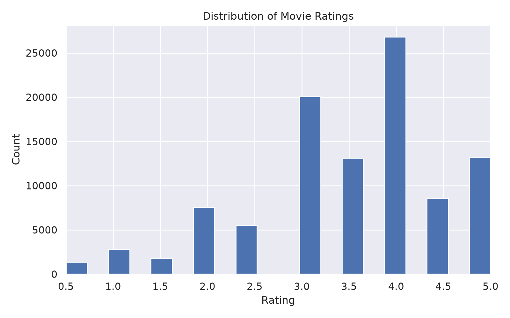

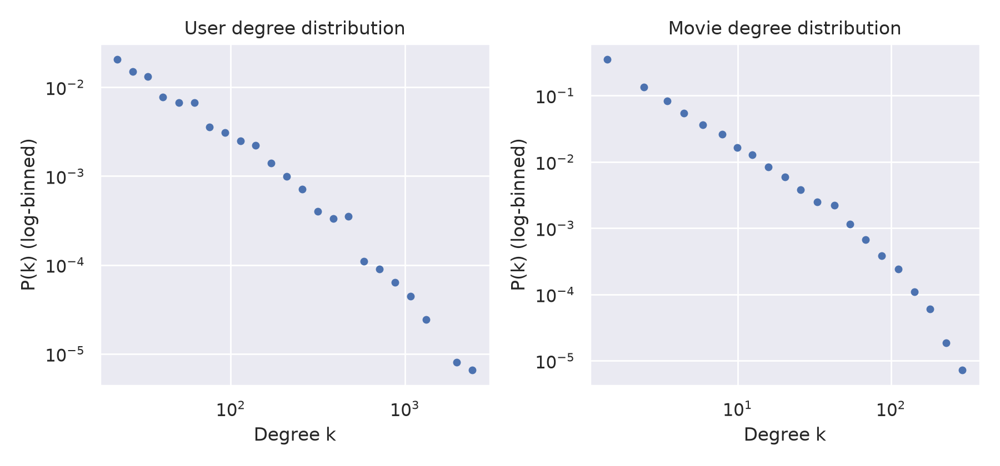

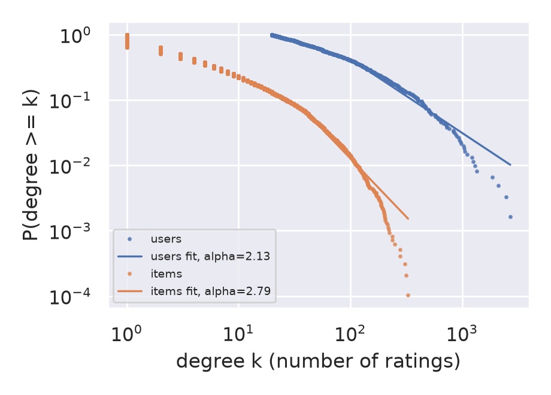

## Experiments

### Practical 1: Data access and exploration

`recsys_data/RatingIndex.py` provides lookups of ratings by user and by movie.
The exploratory scripts report rating and degree distributions, summary
statistics, degree CCDFs, and maximum-likelihood power-law tail fits with
KS-based threshold selection. The data are strongly skewed, especially in movie
popularity, but the sampling and finite-catalog constraints mean the analysis
describes the pattern as heavy-tailed rather than claiming a scale-free graph.

### Practical 2: Bias-only ALS

The first ALS model estimates user and item biases without latent factors. On
the small dataset, the recorded run reached training RMSE **0.7747** and test
RMSE **0.8718**. The regularized training objective decreases over the
alternating updates.

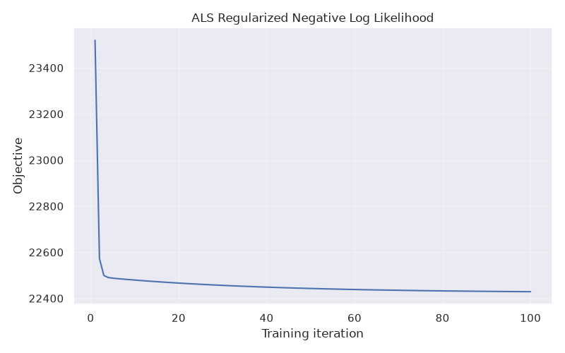

### Practical 3: Explicit matrix factorization

Adding user and item latent vectors improves the rating model when factor
regularization is tuned. With `lambda=0.09`, increasing `tau` from `0.1` to
`0.9` reduced test RMSE from **1.0277** to **0.8549** (training RMSE **0.4546** and
**0.6316**; results in [`output/practice_03/results.json`](output/practice_03/results.json)). This illustrates the sensitivity of the model to
regularization, rather than a comparison across different data splits.

### Practical 4: ALS on MovieLens 32M

The large run uses two compressed sparse row layouts, one ordered by user and
one by item. Numba compiles the update kernels and parallelizes independent row
updates. After 30 epochs, training RMSE was **0.7133** and test RMSE **0.7777**;
the training objective was monotone. The split and final metrics are stored in
[`output/practice_04/results.json`](output/practice_04/results.json).

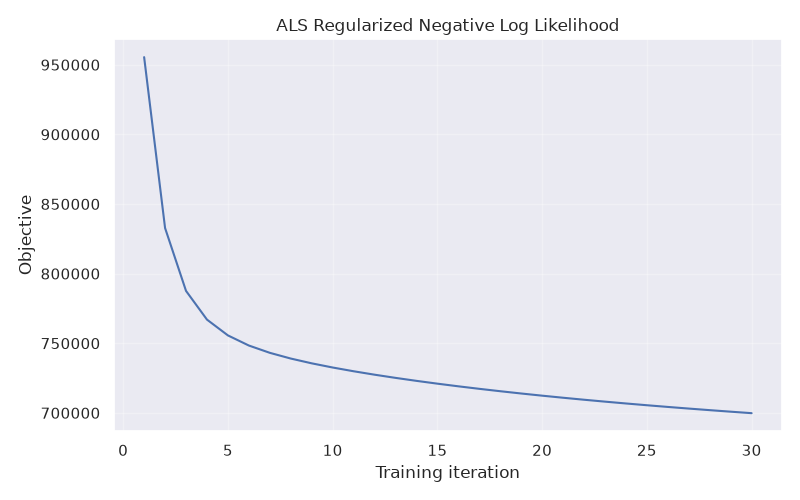

### Practical 5: Genre side information and cold start

The genre-prior model learns genre vectors and uses their normalized sum as
the item-vector prior. For the two-dimensional comparison, test RMSE changed
from **0.8589** (plain factors) to **0.8495** (genre prior). For the
10-dimensional cold-start comparison, it changed from **0.8645** to **0.8454**.
The genre model also had lower RMSE than the plain model in each reported
training-count bucket, including **0.9520 vs. 0.9930** for items with 1-2
training ratings. Embedding figures are generated from the fitted models.
Full metrics, cold-start buckets, neighbours, and model settings:
[`output/practice_05/results.json`](output/practice_05/results.json).

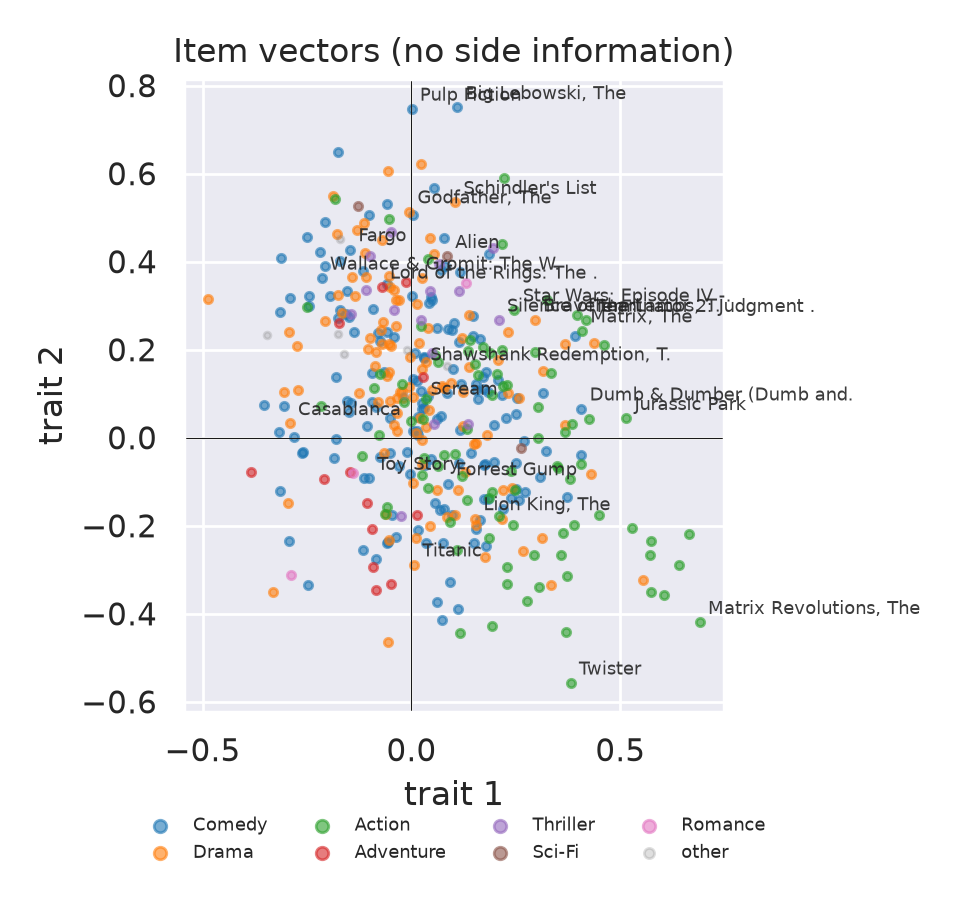

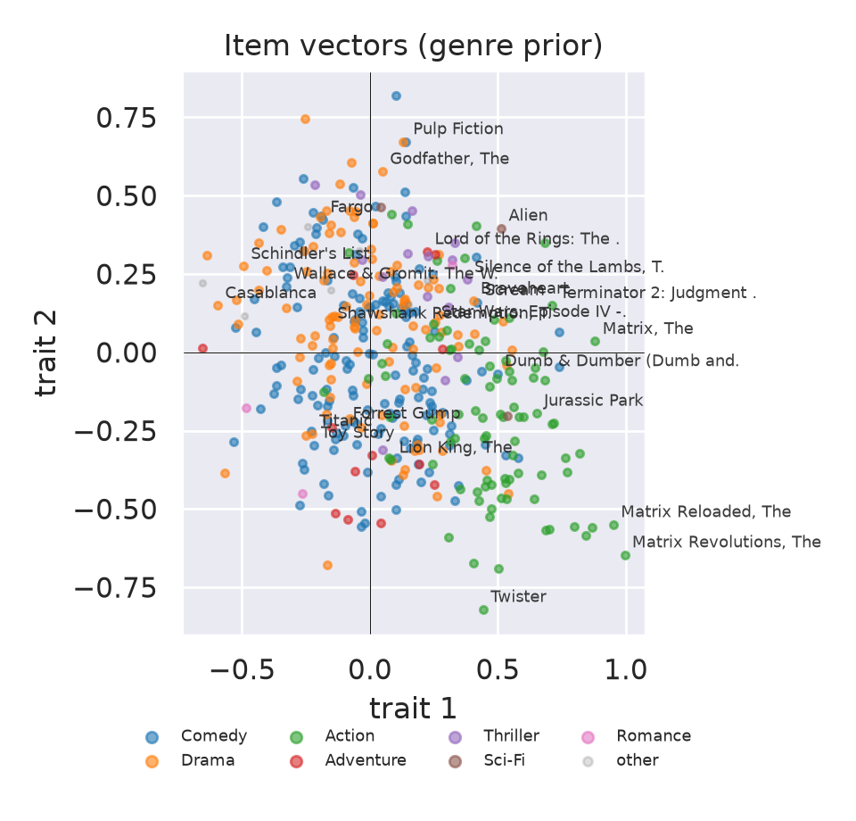

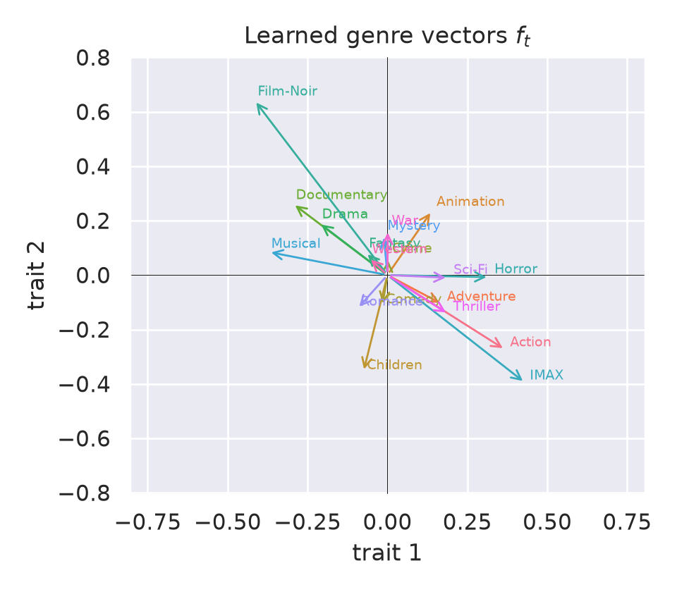

### Practical 6: Implicit feedback with BPR

Ratings of at least **4.0** are treated as positive interactions. The held-out
test set contains **9,630** positive interactions, evaluated for **596** users.
The selected BPR run used regularization `0.01` and 35 epochs; training loss
fell from **0.5005** to **0.0574**.

| Model | Precision@10 | Recall@10 | NDCG@10 | MPR (lower is better) |
| --- | ---: | ---: | ---: | ---: |
| Random | 0.0022 | 0.0008 | 0.0027 | 0.5032 |
| Popularity | 0.0956 | 0.0877 | 0.1256 | 0.1003 |
| Explicit ALS | 0.0344 | 0.0242 | 0.0413 | 0.2248 |
| BPR | **0.1112** | **0.1082** | **0.1411** | 0.1083 |

BPR gave the strongest top-10 precision, recall and NDCG in this run. The
popularity baseline had a slightly lower MPR, showing why ranking metrics
should be read together rather than reduced to a single score. Full metrics at
$k=5,10,20$ and the tuning results are in
[`output/practice_06/results.json`](output/practice_06/results.json).

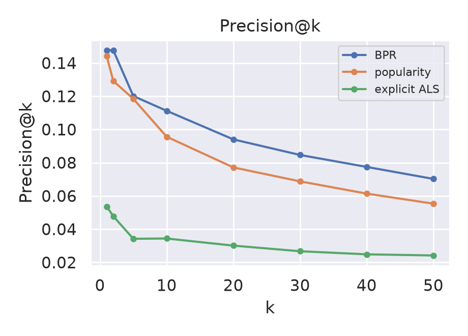

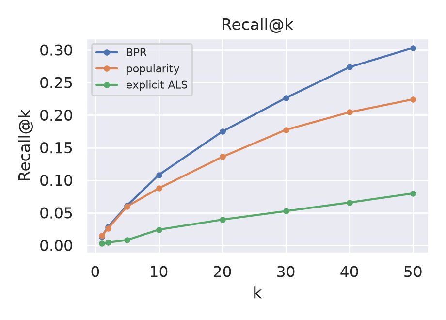

### Practical 7: Recommendation service and simulated A/B test

The `createreco(userid, versionid)` service compares ranking variants A and B.
The run randomized **610 users**, serving 5 sessions of 10 recommendations per
user (**30,500 logged impressions**). Observed simulated CTR was **0.2850** for
A and **0.2023** for B, a difference of **-0.0828** for B relative to A (95%
CI **[-0.0973, -0.0682]**, Welch test $p=1.45\times10^{-26}$). In 500
re-randomizations, estimated power was **1.000** and the A/A false-positive
rate was **0.046**; the single A/A test had $p=0.1709$. Full test outputs and
arm behaviour summaries: [`output/practice_07/results.json`](output/practice_07/results.json).

These numbers are produced by the repository's click simulator and should not
be interpreted as a real product experiment or a forecast of deployed CTR.

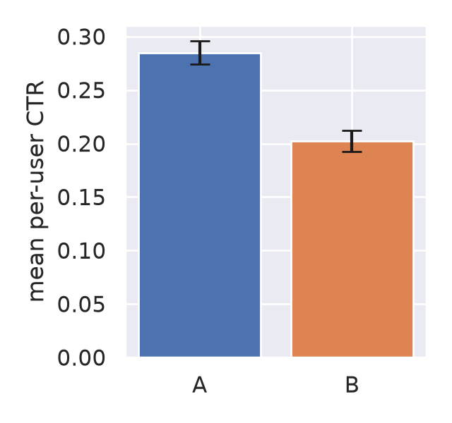

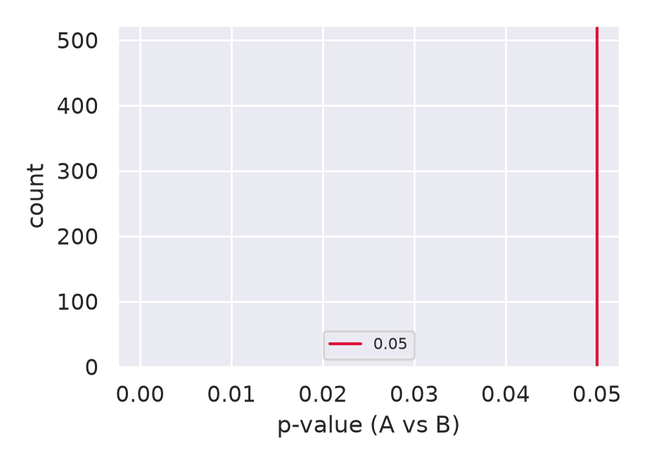

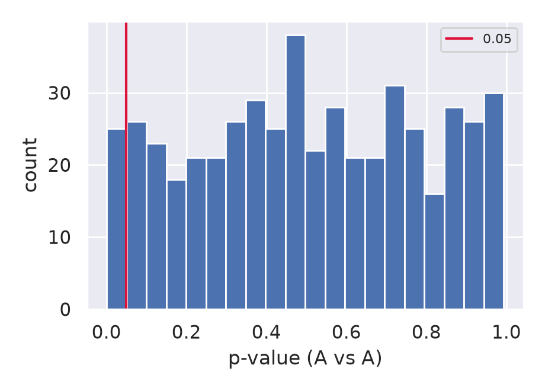

### Practical 8: Hyperparameter and dimension selection

The small-data split had **81,485** training, **9,592** validation, and **9,759**
test ratings. The validation grid selected `lambda=0.09`, `tau=0.9` for the
10-factor grid; its best and worst validation RMSEs were **0.8743** and
**1.2914**. The biases-only sweep selected `gamma=1.0`. After re-tuning `tau`
for each dimension, the best row was `K=32`, `tau=0.9`; its final held-out test
RMSE was **0.8580**, compared with **0.8685** for biases only.
The complete grid and per-dimension runs are in
[`output/practice_08/results.json`](output/practice_08/results.json).

| K | Selected tau | Validation RMSE |
| ---: | ---: | ---: |
| 2 | 0.9 | 0.8651 |
| 4 | 0.9 | 0.8676 |
| 8 | 0.9 | 0.8689 |
| 16 | 0.9 | 0.8729 |
| 32 | 0.9 | **0.8642** |

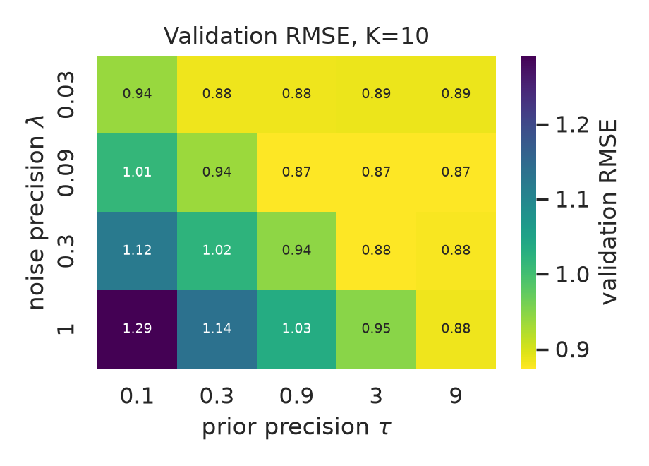

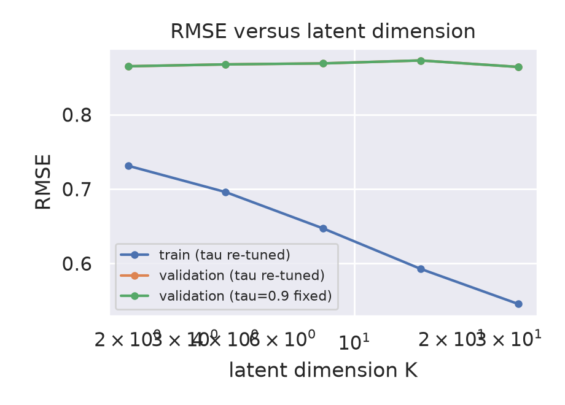

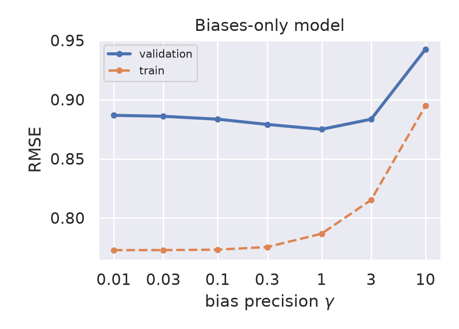

### Practical 9: Fold-in recommendations and polarization

A dummy profile is folded in from three five-star Lord of the Rings ratings,
while item parameters remain fixed. The polarization analysis includes **450**
movies with at least 50 ratings. Item-vector norm and rating standard deviation
had Spearman correlation **0.504**. The highest-norm examples were *Pulp
Fiction*, *Schindler's List*, *The Matrix*, *Ace Ventura: Pet Detective*, and
*Braveheart*. This is a model-based diagnostic, not a direct measure of
individual viewer disagreement. Full recommendation lists and polarization
tables: [`output/practice_09/results.json`](output/practice_09/results.json).

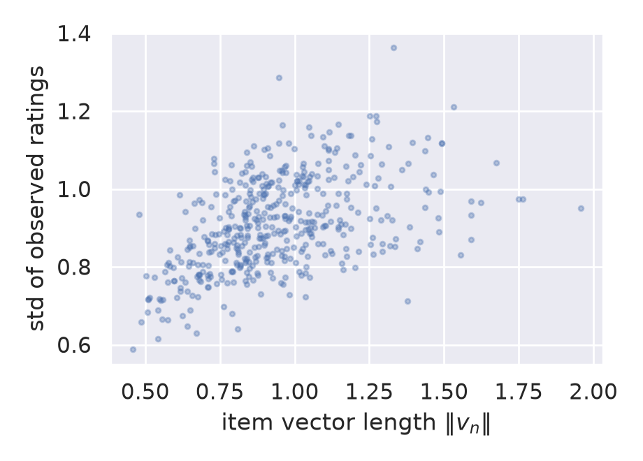

### Practical 10: Variational Bayes

The mean-field Gaussian posterior was compared with MAP/ALS using the same
split and selected dimension. Over 30 iterations, ELBO increased from
**-119,184.4** to **-115,611.5**. Test RMSE was **0.8509** for VB and **0.8580**
for MAP; 90% predictive interval coverage was **92.2%** for VB and **91.0%** for
the constant-variance MAP interval. VB improves test RMSE and coverage in this
run, but the coverage figures are empirical and are not a guarantee of
calibration on other data. Full bucketed metrics and posterior summaries:
[`output/practice_10/results.json`](output/practice_10/results.json).

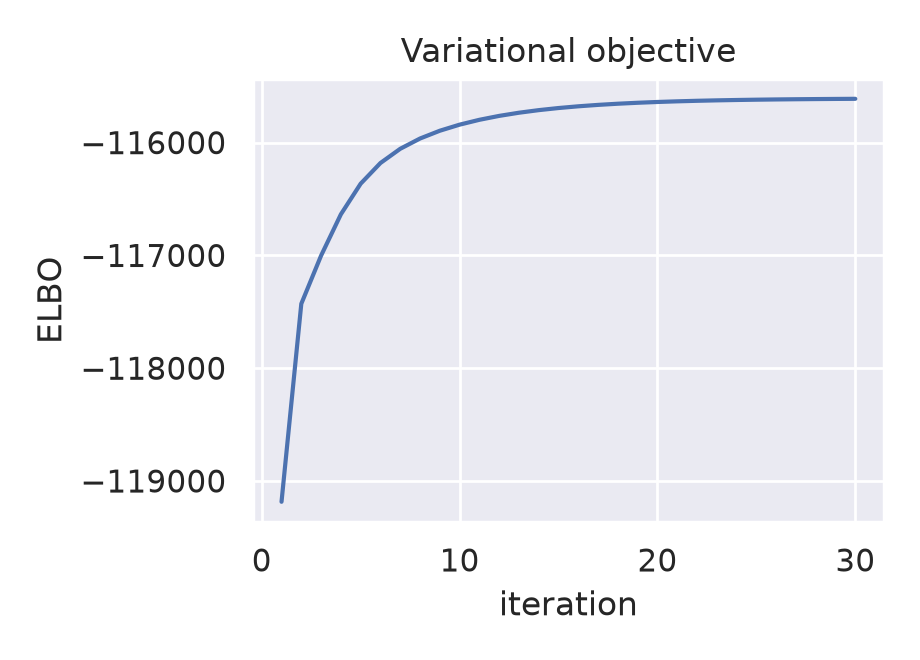

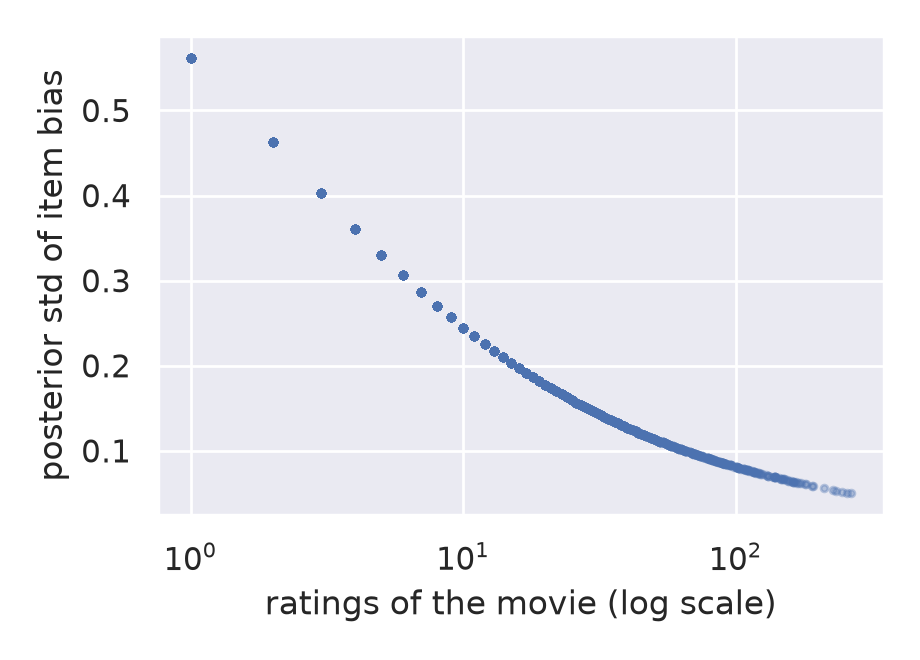

### Parallel scaling benchmark

On MovieLens 32M, measured time per epoch fell from **2.69 s** at one thread to
**1.27 s** at eight threads, a **2.11x** speed-up. Efficiency at eight threads
was **26.4%**. The small-dataset comparison measured **0.166 s/epoch** for the
NumPy ALS implementation and **0.0108 s/epoch** for Numba at eight threads
(**15.4x** in this short benchmark). Timings are machine- and run-dependent;
the 32M measurement used two timed epochs after Numba warm-up.
Full timing and efficiency measurements:
[`output/benchmark/results.json`](output/benchmark/results.json).

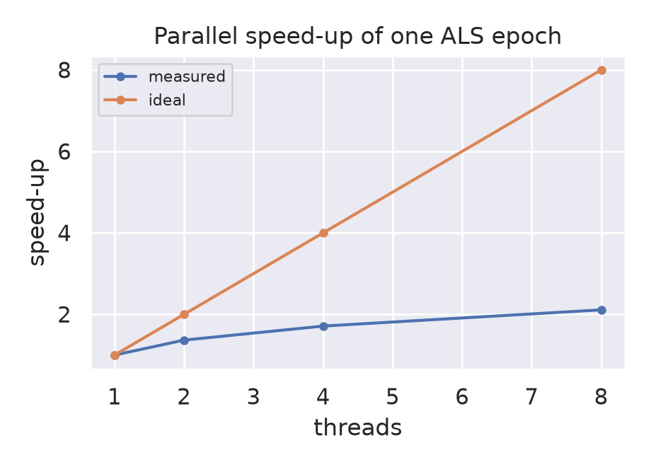

## Setup and reproduction

The checked-in datasets are used by default. From the repository root:

```bash
python3 -m venv .venv
. .venv/bin/activate
python -m pip install --upgrade pip
python -m pip install -r requirements.txt
```

Run the numerical checks or one experiment:

```bash
python tools/sanity_checks.py --data-dir datasets/ml-latest-small
python practice_08.py --data-dir datasets/ml-latest-small
python practice_04.py --data-dir datasets/ml-32m --threads 8
```

Run all numerical checks and practicals:

```bash
PYTHON="$PWD/.venv/bin/python" bash tools/run_all.sh
```

The full pipeline includes the 32M practical and benchmark when
`datasets/ml-32m/ratings.csv` is available. The hyperparameter sweep and large
dataset runs take substantially longer than an individual small-data
experiment. Most experiment scripts accept `--data-dir` and `--output-dir`;
see each script's `--help` for experiment-specific options. The optional
`tools/make_synthetic_movielens.py` exists for smoke tests only and is not used
by the results in this README.

Core implementations are in `recsys_models/`, the parallel ALS implementation
is in `recsys_parallel/`, data utilities are in `recsys_data/`, and service and
experiment simulation code is in `recsys_serving/`.

