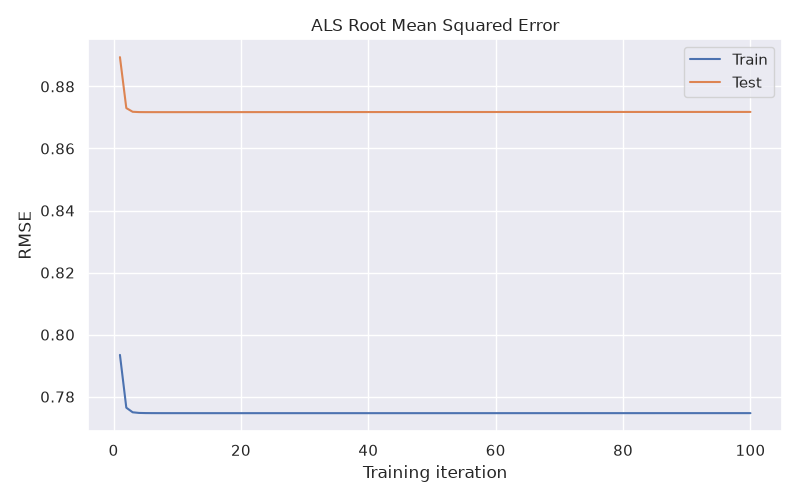
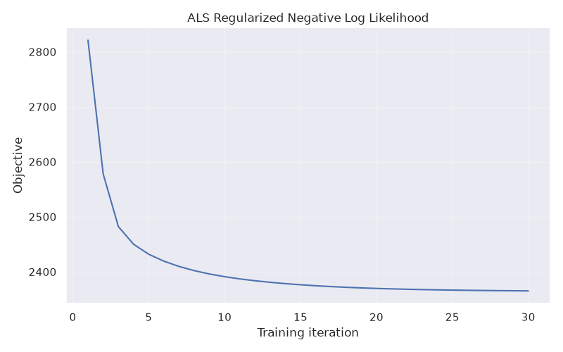
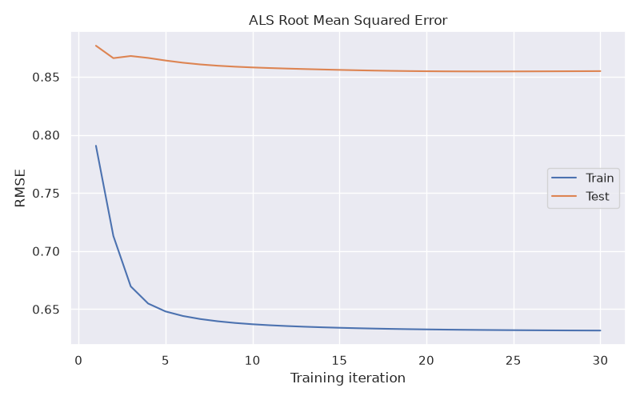
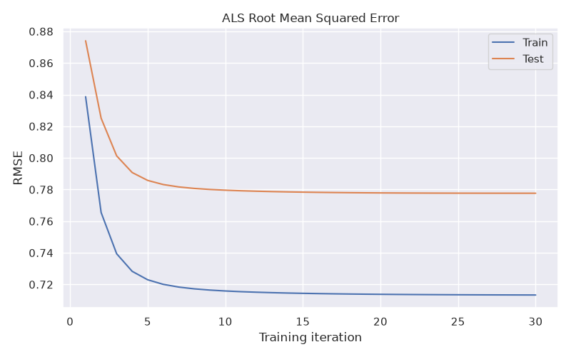

# Recommender Systems Practicals

Small MovieLens experiments covering rating distributions, bias models, and
matrix factorization with alternating least squares (ALS).


Run the scripts from the project root with the included environment, for example:

```bash
./.venv/bin/python practice_01.py
./.venv/bin/python practice_02.py
./.venv/bin/python practice_03.py
./.venv/bin/python practice_04.py --threads 4
```

Practicals 1–3 use `datasets/ml-latest-small`. Practical 4 uses the larger
`datasets/ml-32m` ratings file and saves plots and arrays under `output/`.
Practical 4 uses Numba threads, defaults to at most eight, and accepts a thread
count through `--threads`. The number of epochs and data directory are
configurable with `--epochs` and `--data-dir`.

## Practical 1

`RatingsIndex` stores ratings by user and by movie. Example:

```python
index.get_user_ratings(user_id)
index.get_movie_ratings(movie_id)
```

Rating counts are concentrated around higher scores. The degree plot is
heavy-tailed, but the data does not establish a scale-free network: every user
has at least 20 ratings, truncating the user-degree distribution.


## Practical 2

Alternating least squares estimates user and movie biases. In this run, the
training negative log likelihood decreases over iterations. Training RMSE
converges to **0.7747** and test RMSE to **0.8718**; test error decreases and
then levels off near the training error.


_objective_1.png)



## Practical 3

The ALS model adds user and movie latent vectors, with regularization on both
biases and factors. Increasing factor regularization from `tau=0.1` to `tau=0.9`
with `lambda=0.09` reduces the 30-epoch test RMSE from **1.2826** to **0.8549**
(training RMSE **0.6316**). The comparison used the same split and random seed
for every value.



_objective_0.png)



## Practical 4

Practical 4 fits the latent-factor ALS model to MovieLens 32M. Ratings are
stored in NumPy compressed arrays (`indptr`, `indices`, and `data`), ordered by
user for user updates and by movie for item updates. Numba compiles the update
loops and parallelizes users and movies across threads. User updates finish
before movie updates begin, with a synchronization point between phases. This
Practice 4 data path does not use SciPy.

For a compressed rating matrix with `R` rows and `K` stored ratings, `indptr`
has shape `(R + 1,)` and marks each row's span: row `r` uses positions
`indptr[r]:indptr[r + 1]` in both `indices` and `data`. Both arrays have shape
`(K,)`: `indices` contains column indices (`int32`) and `data` contains rating
values (`float64`). The matrix `shape` records its full `(rows, columns)`
dimensions, including rows with no ratings. User and item index `0..n-1` map
back to original IDs through `user_ids` and `item_ids`.

The 30-epoch example reached training RMSE **0.7133** and test RMSE **0.7777**.
The training objective decreased throughout. The test objective is tracked
separately and is not guaranteed to decrease every epoch. Numba compiles its
kernels on first use, so the initial run includes compilation overhead.

Run with `./.venv/bin/python practice_04.py --threads 8`. Use `--epochs` to
change the number of epochs.


_objective_0.png)

