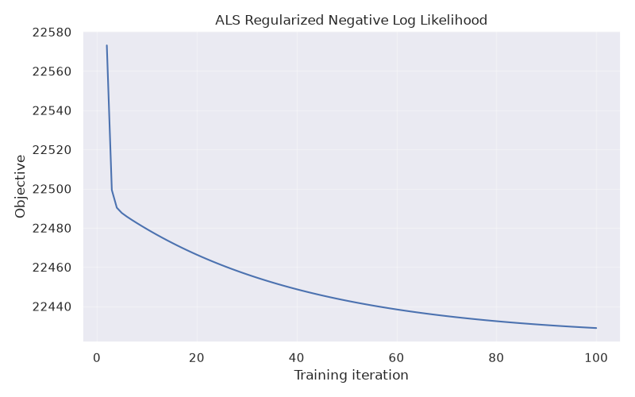
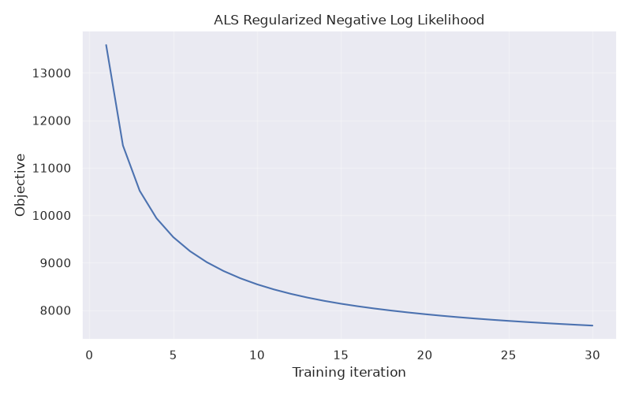
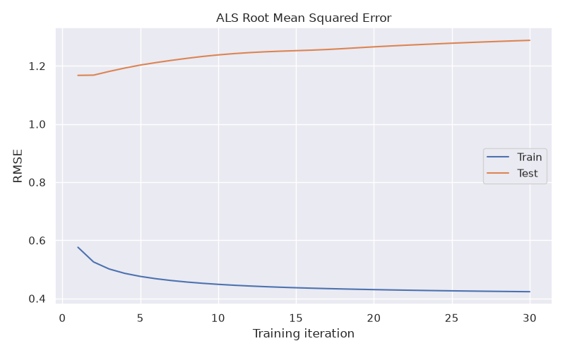

# Recommender Systems Practicals

Small MovieLens experiments covering rating distributions, bias models, and
matrix factorization with alternating least squares (ALS).


Run the scripts from the project root with the included environment, for example:

```bash
./.venv/bin/python practice_01.py
./.venv/bin/python practice_02.py
./.venv/bin/python practice_03.py
```

The scripts use `datasets/ml-latest-small` and save plots under `output/`.

## Practical 1

`RatingsIndex` stores ratings by user and by movie. Example:

```python
index.get_user_ratings(user_id)
index.get_movie_ratings(movie_id)
```

Rating counts are concentrated around higher scores. The degree plot is
heavy-tailed, but the data does not establish a scale-free network: every user
has at least 20 ratings, truncating the user-degree distribution.


## Practical 2

Alternating least squares estimates user and movie biases. In this run, the
training negative log likelihood decreases over iterations. Training RMSE
converges to **0.7747** and test RMSE to **0.8718**; test error decreases and
then levels off near the training error.



_objective_1.png)


## Practical 3

The ALS model adds user and movie latent vectors, with regularization on both
biases and factors. In this run, training loss decreases and training RMSE
converges to **0.4232**. Test RMSE rises to **1.2879**, so it does not follow
training performance.



_objective_0.png)

